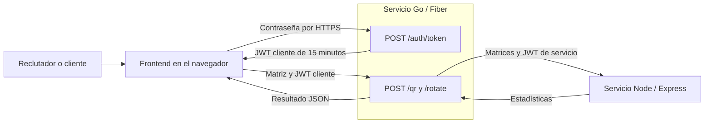
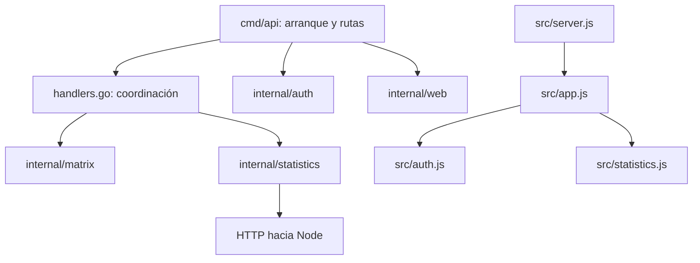

# Arquitectura del proyecto

## 1. Estilo arquitectónico

La solución tiene dos servicios HTTP, organizados internamente por responsabilidades y capas. Go es el punto de entrada y orquesta las transformaciones. Node calcula las estadísticas. El frontend es un cliente web servido por Go.

Esta separación responde a los requisitos de Go/Fiber, Node/Express, comunicación HTTP y contenedores independientes. Las capas corresponden a módulos reales del repositorio; la coordinación de casos de uso está en los manejadores de Go, mientras que los algoritmos se mantienen independientes de HTTP.

## 2. Vista de contenedores



El endpoint de emisión pertenece al servicio Go existente. La incorporación del acceso por contraseña no agrega un tercer servicio ni cambia la dirección Go -> Node exigida por el desafío.

## 3. Capas y módulos

| Capa o responsabilidad | Go | Node / frontend |
| --- | --- | --- |
| Presentación web | internal/web sirve archivos conocidos | frontend/index.html, styles.css y app.js |
| Transporte HTTP | cmd/api configura rutas y respuestas | src/app.js configura Express y rutas |
| Coordinación de aplicación | cmd/api/handlers.go valida y coordina transformación y llamada remota | Los manejadores invocan funciones estadísticas |
| Lógica matemática | internal/matrix: validación, rotación y QR | src/statistics.js: cálculos puros |
| Integración externa | internal/statistics: cliente HTTP de Node | Node recibe peticiones; no llama de vuelta a Go |
| Seguridad transversal | internal/auth: emisión y validación JWT, contraseña y limitador | src/auth.js verifica JWT de servicio |
| Configuración y arranque | cmd/api/main.go lee entorno e inicia Fiber | src/server.js inicia Express |
| Infraestructura de despliegue | Dockerfile de Go y compose.yaml | Dockerfile de Node y render.yaml |

Go usa paquetes con funciones y estructuras. Node usa módulos ES y funciones. El frontend usa jQuery para eventos, AJAX y renderizado; Bootstrap aporta estilos, sin proceso de compilación frontend.

## 4. Dependencias internas



Los algoritmos de internal/matrix no importan Fiber ni el cliente HTTP. Las funciones estadísticas de Node no importan Express. Esta dirección de dependencias permite probar las matemáticas sin levantar servidores y probar HTTP mediante clientes o servicios controlados.

## 5. Estructura del repositorio

```text
matrix-challenge/
├── api-go/
│   ├── cmd/api/                 arranque, manejadores y pruebas HTTP
│   ├── internal/auth/           JWT, contraseña de demostración y limitador
│   ├── internal/matrix/         validación, rotación y QR Householder
│   ├── internal/statistics/     adaptador HTTP autenticado de Node
│   ├── internal/web/            rutas de archivos públicos
│   ├── go.mod / go.sum
│   └── Dockerfile
├── api-node/
│   ├── src/app.js               configuración de rutas y middleware
│   ├── src/server.js            punto de entrada
│   ├── src/auth.js              verificación JWT de servicio
│   ├── src/statistics.js        lógica estadística
│   ├── test/                    pruebas unitarias y HTTP
│   └── Dockerfile
├── frontend/                    formulario y resultados
│   └── vendor/                  Bootstrap y jQuery locales con licencias
├── scripts/                     herramientas operativas y smoke test
├── docs/                        arquitectura, contratos y evidencias
├── compose.yaml                 ejecución local conjunta
├── render.yaml                  definición de servicios gratuitos
└── .env.example                 variables requeridas, sin valores secretos
```

## 6. Estado y persistencia

Los cálculos no requieren base de datos: cada petición incluye todos sus datos y devuelve su resultado. Las matrices no se guardan. El JWT se valida por firma, sin sesión persistente del lado servidor.

El navegador conserva el token solo en memoria. El limitador de intentos mantiene contadores en memoria por proceso; estos se reinician al desplegar. No se presenta ese contador como un control distribuido: con múltiples réplicas sería necesario un almacenamiento compartido.

## 7. Seguridad y acceso de demostración

El operador configura DEMO_PASSWORD fuera del repositorio. El reclutador la escribe en Generar token. Go compara hashes SHA-256 en tiempo constante y, si coincide, firma un JWT cliente de 15 minutos. La respuesta usa Cache-Control: no-store. Se permiten cinco intentos fallidos por minuto y dirección IP observada por el servidor; detrás de un proxy varios clientes pueden compartir ese límite. No se confía automáticamente en cabeceras X-Forwarded-For del cliente.

La contraseña de demostración no es JWT_SECRET: conocer la primera permite solicitar tokens, pero no firmarlos ni crear tokens internos de Node. Node recibe únicamente SERVICE_JWT_SECRET. El frontend no contiene ninguna de estas claves.

Este acceso compartido es apropiado para la demostración controlada. No atribuye identidad individual a cada reclutador ni implementa administración de usuarios. Las credenciales se comparten con el evaluador por separado, fuera del código público.

## 8. Despliegue

Local: dos contenedores en la red Compose. Go publica un puerto; Node permanece interno. El frontend está incluido en el contenedor Go.

Render Free: dos Web Services públicos con TLS, porque el plan gratuito no ofrece Private Services. Go consume la URL HTTPS de Node usando JWT de servicio. Los secretos se inyectan por entorno, los procesos se ejecutan sin root y /health permite verificar cada instancia.

El cálculo de QR, sus límites, el contrato de estadísticas, la convención de nombres y la interpretación del enunciado se sustentan en ARCHITECTURE.md. Los contratos HTTP están en API.md; la operación y variables de nube, en DEPLOY_RENDER.md.